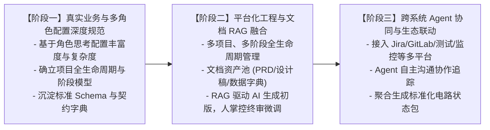
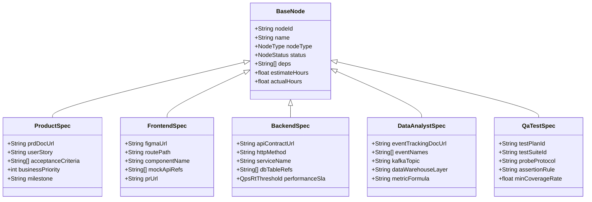
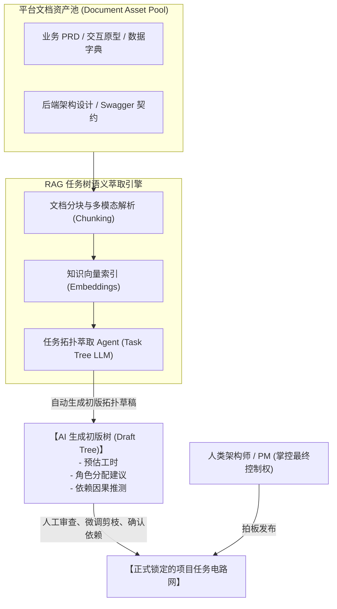
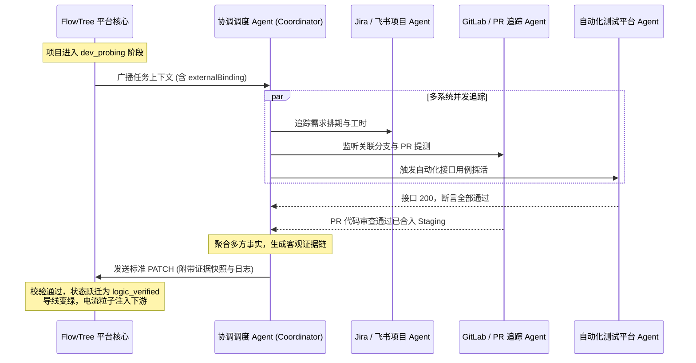

# FlowTree 项目与多角色业务配置约定规范 (Project & Role Configuration Specification)

| 文档版本 | 编制日期 | 战略阶段 | 状态 | 适用受众 |
| :--- | :--- | :--- | :--- | :--- |
| **v1.1.0** | 2026-10-29 | 阶段一：真实业务角色与配置深度规范 | 审阅定稿 | 架构师、PM、研发、QA、数仓分析师、Agent 开发团队 |

---

## 一、 战略演进的三大阶段定位



- **当前聚焦（阶段一）**：不急于盲目铺代码，而是必须**代入到企业真实研发场景中，把各种角色的配置丰富度、复杂度、约束边界和文档结构制定好**。只有配置底座足够坚实扎实，后续的平台化、RAG 生成与多 Agent 对接才不会沦为空谈。

---

## 二、 项目全生命周期阶段模型 (Project Lifecycle Stages)

在真实业务中，一个项目不是静态的，而是会经历严格的阶段流转。任务树的状态与行为由其所处的**项目阶段**严格约束：

```
[ stage_1: 需求拆解与立项 ] ──> [ stage_2: 契约冻结与研发 ] ──> [ stage_3: 自动化探活与冒烟 ] ──> [ stage_4: 人工业务终审 ] ──> [ stage_5: 生产归档 ]
```

| 阶段枚举 (`stage`) | 阶段中文名称 | 核心业务行为 | 对任务树的核心约束 |
| :--- | :--- | :--- | :--- |
| `inception` | 需求拆解与立项 | PM 上传 PRD，AI/RAG 辅助拆解任务初稿，PM 审核定稿。 | **允许**人工任意增删改节点与依赖关系。 |
| `contract_locked` | 契约冻结与排期 | 架构师与各角色技术定型，接口契约（Swagger）与用例冻结。 | **禁止**非 PM 角色修改依赖，拓扑结构锁死。 |
| `dev_probing` | 研发协同与探活 | 研发编码，外部 Agent 自动探活接口通断，点亮逻辑。 | 结构只读；节点接受外部 Agent 推送状态 PATCH。 |
| `staging_review` | 集成验收与体验 | 客观测试全部通过，PM 与业务方体验 UI/交互细节。 | 仅限人类审查员进行 `humanSignOff` 签字。 |
| `production_archived`| 生产发布与归档 | 产出物合入主干，全链路绿灯导通，项目存档沉淀。 | 全树完全只读，作为历史基线与复盘资产。 |

---

## 三、 基于不同角色的配置丰富度与复杂度设计

在现代化大厂研发生态中，不同职位分工对任务的关注点维度完全不同。FlowTree 节点配置模型（`NodeModel`）采用**“通用核心骨架 + 角色专有配置扩展包（Role Extension Packs）”**的设计理念：



---

### 1. 产品经理 / PM 配置包 (`productSpec`)
- **关注点**：业务价值交付、需求溯源、用户故事闭环与人工验收红线。
- **配置结构**：
```json
{
  "productSpec": {
    "prdDocId": "DOC-PRD-2026-MALL-01",
    "prdSectionAnchor": "#user-login-flow",
    "userStory": "作为普通买家，我希望使用手机验证码快捷登录，以便 5 秒内完成支付结算",
    "businessValueWeight": 9,
    "targetMilestone": "M1_CORE_SMOKE",
    "acceptanceCriteria": [
      "未注册手机号输入正确验证码后自动注册并登录成功",
      "图形验证码防刷机制连续错误 3 次触发",
      "登录凭证有效期 7 天，支持多端互踢策略"
    ],
    "humanSignOffRequired": true
  }
}
```

---

### 2. 前端工程师配置包 (`frontendSpec`)
- **关注点**：UI 还原度、Figma 画布锚点、组件层级与路由。
- **配置结构**：
```json
{
  "frontendSpec": {
    "figmaDesignUrl": "https://figma.com/file/xyz?node-id=102:45",
    "routePath": "/auth/quick-login",
    "componentName": "QuickLoginModal",
    "mockApiReady": true,
    "viewportSupport": ["mobile_h5", "wechat_miniapp", "web_pc"],
    "codeRepository": "git@github.com:mall/frontend-app.git",
    "pullRequestUrl": "https://github.com/mall/frontend-app/pull/128"
  }
}
```

---

### 3. 后端研发与架构师配置包 (`backendSpec`)
- **关注点**：接口契约稳定性、数据库事务隔离、微服务调用、性能 SLA。
- **配置结构**：
```json
{
  "backendSpec": {
    "serviceName": "auth-passport-service",
    "apiContract": {
      "format": "openapi_v3",
      "schemaUrl": "https://api.mall.internal/docs/v1/auth.json",
      "method": "POST",
      "endpoint": "/api/v1/auth/sms-login"
    },
    "dbMigrations": [
      "db/migrations/20261029_create_users_table.sql",
      "db/migrations/20261029_create_sms_logs_table.sql"
    ],
    "rpcDependencies": [
      "sms-gateway-service:SendSms",
      "risk-control-service:CheckDeviceRisk"
    ],
    "performanceSla": {
      "targetQps": 2000,
      "p99LatencyMs": 50
    }
  }
}
```

---

### 4. 数据分析师 / 数仓配置包 (`dataAnalystSpec`)
- **关注点**：埋点事件标准化、数仓分层（ODS/DWD/DWS）、指标计算口径一致性。
- **配置结构**：
```json
{
  "dataAnalystSpec": {
    "eventTrackingDocId": "DOC-TRACKING-MALL-LOGIN",
    "eventNames": [
      "app_login_button_click",
      "sms_code_sent",
      "login_result_callback"
    ],
    "kafkaTopic": "mall.event.client_telemetry_v1",
    "dwPipeline": {
      "odsTable": "ods_mall_user_login_log_hi",
      "dwdTable": "dwd_trade_user_login_di",
      "sparkJobPath": "dw/jobs/dwd_user_login_stream.py"
    },
    "metricFormula": {
      "metricName": "短信验证码登录转化率",
      "formula": "count(distinct login_success_uid) / count(distinct click_login_uid)",
      "dashboardUrl": "https://bi.mall.internal/report/login_funnel"
    }
  }
}
```

---

### 5. 质量保证 / QA 测试配置包 (`qaTestSpec`)
- **关注点**：自动化探活协议、测试用例覆盖、冒烟断言规则与外部测试平台联动。
- **配置结构**：
```json
{
  "qaTestSpec": {
    "testSystem": "autoprobe_matrix",
    "testPlanId": "PLAN-SMOKE-2026-DAILY",
    "testSuiteId": "SUITE-AUTH-LOGIN-001",
    "probeProtocol": "HTTP_JSON",
    "probeIntervalCron": "*/10 * * * *",
    "probeExecutionConfig": {
      "endpoint": "https://staging-api.mall.internal/api/v1/auth/sms-login",
      "method": "POST",
      "mockPayload": {
        "mobile": "13800000000",
        "verifyCode": "888888"
      },
      "expectedAssertions": [
        "response.status_code == 200",
        "response.json().code == 'SUCCESS'",
        "response.json().data.token != null"
      ]
    },
    "blockingThreshold": "any_failure"
  }
}
```

---

## 四、 平台化与文档资产池（RAG 接入规范约定 - 阶段二准备）

在阶段二中，FlowTree 将引入**“文档资产池（Document Pool）与 RAG 任务树萃取引擎”**，其约定规范如下：



### 1. 核心契约原则：AI 出草稿，人类定乾坤
- **禁止 AI 全自动上线**：AI / RAG 根据文档解析出的结构一律标注为 `isDraft: true`；
- **人机协同工作台**：平台提供可视化对比界面（Diff Viewer），人类架构师可以：
  - 点击“采纳” / “合并拆解过细的节点” / “纠正错误的依赖先后顺序”；
  - 一旦人类点击“发布基准树（Promote to Baseline）”，版本号提升为 `v1.0.0`，正式进入开发流转。

---

## 五、 跨系统 Agent 交互与协同协议（阶段三生态准备）

为了让系统在 AI 时代具备强大的生命力，FlowTree 预留了统一的 **`Agent Ecosystem Gateway`（多智能体对接协议）**：



### 1. 标准化 Agent 证据包格式 (Agent Evidence Payload)
外部 Agent 向 FlowTree 回传状态时，统一封装证据链：
```json
{
  "nodeId": "api-001",
  "status": "logic_verified",
  "evidence": {
    "sourceAgent": "qa_probe_agent_03",
    "verifiedAt": "2026-10-29T18:50:00Z",
    "testExecution": {
      "suiteId": "SUITE-AUTH-LOGIN-001",
      "totalCases": 12,
      "passedCases": 12,
      "failedCases": 0,
      "p99LatencyMs": 38
    },
    "gitCommit": {
      "sha": "a1b2c3d4",
      "branch": "feat/sms-login",
      "prUrl": "https://github.com/mall/app/pull/128"
    }
  },
  "reviewComments": [
    "【自动化 Agent 验收报告】代码已合并，接口探活 12 个用例全部通过，耗时 38ms，建议人工验收体验。"
  ]
}
```

---

## 六、 阶段一落地执行规范清单

从当下开始，我们在数据结构与业务落地中全面遵循本规范：
1. **完善 Schema 定义**：在 `backend/app/core/schema.py` 中引入 `ProjectStage`、角色扩展包规范字典；
2. **多项目大盘配置化**：支持加载多个具有不同业务场景（电商交易、风控中台、数据数仓）的标准化项目配置文件；
3. **沉淀规范文档**：作为后续所有平台功能（阶段二）与 Agent 对接（阶段三）的顶层契约。
