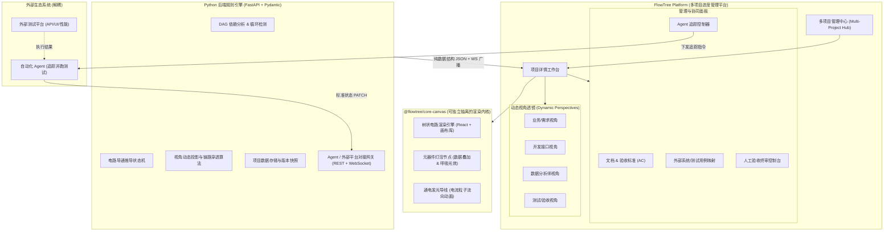

# FlowTree 智能项目状态电路引擎｜第一版项目计划书 & 产品规范 (v1.0)

> **定位**：基于数据结构驱动的「树状状态电路流转与多视角项目管理平台」  
> **核心哲学**：让客观逻辑自动化流转与验证，将主观体验留给人类做最终裁决。

---

## 一、 项目背景与核心愿景

### 1.1 项目背景
在现代化团队与多 Agent 协同研发流程中，传统项目管理工具（如 Jira、飞书多维表格等）面临三大痛点：
1. **状态流向不直观**：列表或卡片堆积，无法直观反映上游输入、下游阻塞和因果流动关系。
2. **自动化与人工边界不清**：要么全部靠人工手动改状态，虚报或遗漏频发；要么试图让 AI 全权包揽，由于缺乏主观审美和体验把关导致质量失控。
3. **视角僵化与割裂**：不同业务条线（前端、后端、测试、数据分析师、合规等）无法在同一份底层任务数据上各取所需、敏捷协同。

### 1.2 核心愿景
FlowTree 旨在构建一个**以标准数据结构为底座、以物理电路通电为视觉隐喻、以动静解耦为原则的项目流转引擎与管理平台**：
- **物理电路隐喻**：任务如元器件，连线如导线；前置逻辑通了，导线通电发光注入电流，下游像灯泡一样被逐个点亮；一旦出现断言或逻辑异常，电路熔断报警，全链路一目了然。
- **人机边界明晰**：系统专注做好**客观、标准化、重复的逻辑验证与状态推导**；主观的美观、交互手感与商业决策**坚决保留给人类验收**。
- **两层架构设计**：
  - **核心渲染层 (`@flowtree/core-canvas`)**：纯受控、轻量级、可独立抽离甚至单独发包的通用树状电路图渲染 SDK。
  - **平台业务层 (`FlowTree Platform`)**：多项目管理工作台，包含动态视角透镜、文档与契约映射、测试绑定、以及调度 Agent 追踪各外部平台状态的智能驾驶舱。

---

## 二、 核心设计原则（产品灵魂）

### 2.1 客观逻辑机器验，主观体验人类审
- **机器/Agent 验收范围**：接口 HTTP 状态码、契约断言、单元测试通过率、Schema 一致性、数据管道链路连通等标准化的客观事实。
- **人类验收范围**：UI 视觉美观度、交互体验平滑度、业务边界妥协与产品定版。
- **状态机控制**：自动化验证通过仅代表“逻辑导通（Logic Verified）”，仍需预留“人工终审（Human Sign-off）”卡点，确保交付万无一失。

### 2.2 结构变更人说了算，状态更新自动推
- **树结构（增删改节点、调整因果依赖）**：属于项目架构定义，绝对仅限人工操作确认，禁止 Agent 擅自修改边界。
- **状态流转（通电变绿、报错变红、耗时回填）**：由外部测试平台或 Agent 自动化跑完逻辑后，通过标准 `PATCH` 增量推送，无需人工搬砖。

### 2.3 动态视角透镜（Dynamic Perspectives）
- 摒弃写死的角色枚举。视角本质是**任务拓扑网在特定业务维度的动态投影**。
- 管理员可自由创建自定义视角（如「数据分析师视角」、「测试链路视角」、「合规审计视角」）。
- 引擎负责根据标签规则裁剪子图，并智能进行**依赖穿透/折叠**，确保上下游输入输出关系不因局部节点过滤而失真。

### 2.4 UI 与逻辑彻底分离
- 后端规则引擎纯粹输出标准 Graph 数据结构（`nodes` + `edges`），包含预计算的通电电气状态（`energized` / `dormant` / `blocked`）。
- 前端渲染器纯粹根据数据绘制，无任何硬编码业务耦合，随时可移植。

---

## 三、 系统分层架构



---

## 四、 核心数据模型与契约规范

### 4.1 节点模型（Node Schema）
```json
{
  "nodeId": "node-api-login",
  "parentId": "mod-auth",
  "nodeType": "api",
  "name": "用户登录接口",
  "description": "基于 JWT 的统一鉴权接口",
  "tags": ["backend", "auth", "security", "core_path"],
  "assignRole": "backend_dev",
  "assignee": "alex",
  "status": "pending_dev",
  "deps": ["node-db-user-schema"],
  
  "acceptanceCriteria": [
    "正确账密返回 200 及 AccessToken",
    "错误账密返回 401 明确语义错误",
    "连续失败 5 次触发验证码"
  ],
  
  "externalBinding": {
    "system": "api_test_platform",
    "targetType": "test_suite",
    "targetId": "SUITE-AUTH-001",
    "autoProbe": {
      "endpoint": "/api/v1/auth/login",
      "method": "POST"
    }
  },
  
  "estimateHours": 4.0,
  "actualHours": 1.5,
  
  "outputs": [
    "src/modules/auth/service.py",
    "docs/api/auth.swagger.json"
  ],
  
  "review": {
    "logicVerified": true,
    "logicVerifiedBy": "agent_worker_01",
    "logicVerifiedAt": "2026-10-29T10:00:00Z",
    "humanSignOff": false,
    "humanSignOffBy": null,
    "humanComments": []
  }
}
```

### 4.2 动态视角定义模型（Perspective Definition）
```json
{
  "viewId": "view-analytics",
  "name": "数据分析师视角",
  "description": "关注指标口径、事件埋点及数据处理任务链路",
  "icon": "LineChart",
  "filter": {
    "includeTags": ["analytics", "bi", "data_pipeline"],
    "includeNodeTypes": ["feature", "api", "data_model"],
    "bypassUnmatched": true
  }
}
```
*`bypassUnmatched: true` 说明：当上游节点 A 和下游节点 C 匹配该视角，而中间节点 B 被过滤时，引擎自动建立 A $\rightarrow$ C 的穿透虚线连接，确保业务因果链路不中断。*

### 4.3 渲染引擎输入契约（Core Canvas Payload）
后端为前端渲染引擎直接计算好的纯拓扑数据：
```json
{
  "projectId": "proj-ecommerce",
  "viewId": "view-analytics",
  "stats": {
    "totalNodes": 18,
    "energizedNodes": 10,
    "blockedNodes": 1,
    "progressRate": 0.55
  },
  "nodes": [
    {
      "id": "node-api-login",
      "label": "用户登录接口",
      "nodeType": "api",
      "status": "review_pass",
      "bulbState": "illuminated_green",
      "dataOverlay": {
        "assignee": "alex",
        "hasExternalTest": true,
        "hours": "1.5/4h"
      }
    }
  ],
  "edges": [
    {
      "id": "e_db_to_login",
      "source": "node-db-user-schema",
      "target": "node-api-login",
      "circuitState": "energized",
      "flowAnimation": true,
      "strokeColor": "#10B981"
    }
  ]
}
```

### 4.4 状态流转规则（状态机与通电逻辑）

```
[ pending_dev (灰色沉睡) ]
       │
       ▼ (前置依赖节点全部通电导通)
[ deving (黄色呼吸·电流注入) ]
       │
       ▼ (Agent/外部测试跑通客观逻辑)
[ logic_verified (亮蓝·待人工终审) ]
       │
       ├──────────────────────────────┐
       ▼ (人工终审通过)                ▼ (人工驳回或测试异常)
[ human_approved / review_pass ]   [ review_reject / blocked ]
   (翠绿点亮灯泡，继续向下游放电)      (警示红常亮，电路短路熔断，阻断下游)
```

---

## 五、 项目工程划分与实施路线 (Phase 1 MVP)

### 5.1 代码仓库目录架构
```
virtual-manage/
├── docs/
│   └── PROJECT_PROPOSAL.md     # 本项目计划书与完整产品规范
├── backend/                    # Python 后端平台服务
│   ├── app/
│   │   ├── core/               # 纯规则引擎 (零外部环境依赖)
│   │   │   ├── schema.py       # Pydantic 核心数据契约
│   │   │   ├── statemachine.py # 状态机与两段式验收（逻辑+人工）
│   │   │   ├── dag.py          # 拓扑排序、环检测与电路导通推导
│   │   │   ├── lens.py         # 动态视角过滤与穿透算法
│   │   │   └── store.py        # 多项目本地 JSON 存储与版本快照
│   │   ├── api/                # FastAPI 接口
│   │   │   ├── routes_project.py  # 多项目 CRUD
│   │   │   ├── routes_view.py     # 获取特定视角渲染数据
│   │   │   ├── routes_patch.py    # 外部 Agent / 测试 PATCH 入口
│   │   │   └── routes_ws.py       # WebSocket 实时电路状态广播
│   │   └── main.py             # 启动入口
│   └── tests/                  # 100% 覆盖的核心逻辑单元测试
├── frontend/
│   ├── packages/
│   │   └── core-canvas/        # 【独立渲染 SDK】受控树状电路画布
│   │       ├── src/
│   │       │   ├── CircuitCanvas.tsx  # 主画布
│   │       │   ├── nodes/             # 灯泡元器件节点实现
│   │       │   ├── edges/             # 通电发光与流动粒子边
│   │       │   └── types.ts           # 纯视图数据契约
│   └── apps/
│       └── platform-web/       # 【多项目管理平台主站】
│           ├── src/
│           │   ├── pages/Projects.tsx    # 多项目看板
│           │   ├── pages/Workbench.tsx   # 工作台 (嵌入 Canvas)
│           │   ├── components/ViewsBar.tsx # 动态视角切换与新建
│           │   └── components/ReviewDrawer.tsx # 逻辑报告与人工终审
└── README.md
```

### 5.2 第一阶段（Phase 1）详细交付清单
1. **里程碑 1：核心数据引擎与算法**
   - 编写 Pydantic 数据规范与 Schema 校验；
   - 编写 DAG 拓扑分析、闭环检测、动态视角穿透算法；
   - 编写通电逻辑（依赖前置节点 `review_pass` 后自动将边置为 `energized`，下游激活）；
   - 编写 pytest 自动化测试，确保纯数据逻辑万无一失。
2. **里程碑 2：FastAPI 数据服务与实时网关**
   - 实现多项目读取与持久化；
   - 实现纯数据结构输出接口（前端拿到的即是完整 node/edge 渲染包）；
   - 提供外部 Agent / 测试调用的 `PATCH /api/nodes/{id}/status` 接口；
   - 集成 WebSocket，节点状态变更秒级广播。
3. **里程碑 3：可抽离的 React 核心渲染组件 (`core-canvas`)**
   - 实现基于现代节点流库的受控画布组件；
   - 定制发光灯泡节点（数据叠加徽标、呼吸动效）；
   - 定制带动态电流粒子的导通连线。
4. **里程碑 4：项目管理工作台主应用 (`platform-web`)**
   - 多项目切换看板；
   - 自定义视角透镜切换（业务、开发、数据分析师、测试等）；
   - 节点详情抽屉（查看契约、验收标准、测试映射、人工终审通过/打回操作）；
   - 模拟 Agent 外部推送演示（一键触发，全屏电路动态点亮）。
