# FlowTree 智能项目状态电路引擎｜工作分解结构与交付计划 (WBS & Delivery Plan)

| 文档版本 | 状态 | 编写角色 | 面向对象 | 最终定稿时间 |
| :--- | :--- | :--- | :--- | :--- |
| **v1.0.0** | 执行中 (In Execution) | 项目经理 (PMP / Delivery Lead) | 全体研发人员、QA、干系人 | 2026-10-29 |

---

## 1. 项目交付目标与周期 (Phase 1 MVP)

- **总周期**：预估 12~14 人天（敏捷双周迭代交付 MVP）。
- **交付目标**：
  1. 交付零外部依赖的 Python 核心数据引擎（DAG 计算、状态机、透镜算法、单元测试全覆盖）；
  2. 交付完全解耦的可独立抽离渲染 SDK（`@flowtree/core-canvas`）；
  3. 交付多项目管理平台主站（支持视角切换、灯泡发光动效、人工终审抽屉与 Agent PATCH 联动变色）。

---

## 2. 工作分解结构 (WBS 3-Level Breakdown)

```mermaid
flowchart TD
    WBS["FlowTree Phase 1 MVP"]
    
    WBS --> M1["1.0 后端核心规则引擎 (Python)"]
    M1 --> M1_1["1.1 Pydantic Schema 与契约校验"]
    M1 --> M1_2["1.2 DAG 环检测与电路导通推导"]
    M1 --> M1_3["1.3 动态视角过滤与穿透算法"]
    M1 --> M1_4["1.4 状态机与两段式流转校验"]
    M1 --> M1_5["1.5 核心逻辑 pytest 单元测试"]
    
    WBS --> M2["2.0 服务网关与实时通信 (FastAPI)"]
    M2 --> M2_1["2.1 多项目本地存储与版本管理"]
    M2 --> M2_2["2.2 确定性拓扑渲染数据 API"]
    M2 --> M2_3["2.3 防篡改状态 PATCH API"]
    M2 --> M2_4["2.4 WebSocket 状态实时广播"]
    
    WBS --> M3["3.0 独立电路渲染内核 (@flowtree/core-canvas)"]
    M3 --> M3_1["3.1 树状电路拓扑布局组件"]
    M3 --> M3_2["3.2 元器件发光灯泡节点与数据叠加"]
    M3 --> M3_3["3.3 通电发光导线与电流流动粒子动画"]
    M3 --> M3_4["3.4 纯受控 Props 契约封装与打包"]
    
    WBS --> M4["4.0 项目管理工作台平台 (Platform Web)"]
    M4 --> M4_1["4.1 多项目看板大盘页面"]
    M4 --> M4_2["4.2 动态视角透镜切换与新建面板"]
    M4 --> M4_3["4.3 节点详情与人工体验终审抽屉"]
    M4 --> M4_4["4.4 模拟外部 Agent 状态注入演示器"]
```

---

## 3. 详细排期与里程碑 (Milestones)

| 里程碑 | 交付物 | 耗时 | 准出条件 (Exit Criteria) |
| :--- | :--- | :--- | :--- |
| **M1: 规则内核交付** | `backend/app/core/` 核心模块 | 3 天 | 状态机、DAG 穿透算法编写完成，pytest 单元测试全部通过。 |
| **M2: API 与网关交付**| FastAPI 路由 + WebSocket 服务 | 2 天 | Swagger API 可用，PATCH 接口具备防结构篡改拦截能力。 |
| **M3: 渲染 SDK 交付** | `packages/core-canvas/` 组件 | 3 天 | 实现独立树状画布，5 种灯泡发光状态与连线流动粒子动效正常。 |
| **M4: 平台集成交付** | `apps/platform-web/` 完整前端 | 3 天 | 完成项目看板、视角切换、人工抽屉审批、WS 实时变色全链路打通。 |
| **M5: 验收与演示** | 端到端联调与 Demo 脚本 | 1 天 | 模拟外部 Agent 推送测试结果，演示全屏电路自动点亮与人工终审流程。 |

---

## 4. 关键交付准则 (Definition of Done - DoD)

每个模块交付合并时必须严格执行以下准则：
1. **代码规范与类型安全**：
   - 后端全部代码必须通过 Pydantic / mypy 严格类型检测；
   - 前端全部代码必须通过 TypeScript 零 `any` 编译。
2. **解耦边界红线**：
   - `core-canvas` 严禁出现任何 `axios` / `fetch` 或特定项目接口调用，只接收 `nodes` 与 `edges`；
   - 外部 Agent PATCH 严禁包含树结构修改，后端必须包含单元测试验证该安全拦截。
3. **视觉还原度标准**：
   - 必须肉眼可见连线的电流流动粒子（Flow Particle Animation）；
   - 节点发光灯泡必须具备清晰的状态语义（绿/黄/蓝/红/灰），不可退化为单调文字框。

---

## 5. 风险卡点与应对预案 (Risk Register)

| 风险描述 | 严重级别 | 应对策略 |
| :--- | :--- | :--- |
| **1. 动态视角过滤后断链** | 高 | 算法层实现 `bypassUnmatched` 自动穿透连线，确保上游有效输入直通下游。 |
| **2. 画布节点过多卡顿** | 中 | 采用虚拟化渲染与轻量 Canvas/SVG 粒子，控制单屏 DOM 数量。 |
| **3. 外部 Agent 推送非法跃迁** | 高 | 状态机代码层面硬性拦截，非法跃迁返回友好错误提示并记录审计日志。 |
